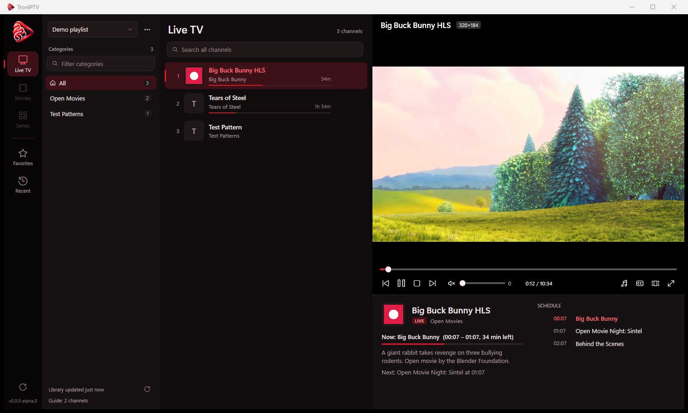

<div align="center">


# TronIPTV

**A fast, modern, open-source IPTV player for Windows.**

[](https://github.com/armendzekjiri/TronIPTV/actions/workflows/ci.yml)
[](https://github.com/armendzekjiri/TronIPTV/actions/workflows/codeql.yml)
[](https://github.com/armendzekjiri/TronIPTV/releases)
[](https://github.com/armendzekjiri/TronIPTV/releases)
[](LICENSE)


[Download](https://github.com/armendzekjiri/TronIPTV/releases) ·
[Report a bug](https://github.com/armendzekjiri/TronIPTV/issues/new/choose) ·
[Contributing](CONTRIBUTING.md) ·
[Changelog](CHANGELOG.md)

</div>



## Features

- **Your providers:** Xtream Codes logins, M3U/M3U8 URLs, and local M3U files, with as many playlists as you like.
- **Live TV, Movies, Series:** live channels as a fast list; movies and series as a poster grid with ratings. Series open into seasons and episodes, which auto-advance.
- **TV guide (XMLTV):** now/next with progress in the channel list and a full schedule panel. Guides come from the playlist, from Xtream `xmltv.php`, or from a custom URL (`.xml` or `.xml.gz`).
- **Instant startup:** your library is saved locally after the first load, so 100,000+ titles open in seconds. It only re-downloads when you choose **Update**.
- **Two searches:** filter categories and search channels or titles independently.
- **Favorites and Recent,** kept per playlist.
- **Plays nearly anything:** powered by libVLC. Supports HLS, MPEG-TS, RTMP, HEVC and AC3/E-AC3, with hardware decoding, audio/subtitle track selection, aspect ratios, and seeking.
- **Resilient:** live streams reconnect automatically with backoff, and offline providers fall back to the saved library.
- **Private by design:** passwords, playlist URLs and the saved library are encrypted with Windows DPAPI for your user account. No telemetry, and no network calls except to your providers and GitHub when you check for updates.

## Install

Download the latest release from the [Releases page](https://github.com/armendzekjiri/TronIPTV/releases):

| File | Use it when |
| --- | --- |
| `TronIPTV-<version>-win-x64-setup.exe` | You want a normal install with a Start-menu entry and uninstaller. No admin rights are needed. |
| `TronIPTV-<version>-win-x64-portable.zip` | You want to run it from any folder or a USB stick. |

Requirements: Windows 10 1809 or later, 64-bit. The .NET runtime is bundled.

Every release ships `SHA256SUMS.txt` and a GitHub build-provenance attestation. To verify a download:

```bash
gh attestation verify TronIPTV-0.1.0-win-x64-setup.exe --repo armendzekjiri/TronIPTV
```

> Releases are not code-signed yet, so Windows SmartScreen may warn on first launch. Choose **More info → Run anyway**.

## Usage

1. Click **⋯ → Add playlist** and enter an Xtream Codes login, an M3U URL, or a local M3U file.
2. Pick **Live TV**, **Movies** or **Series** in the left rail, then a category.
3. Double-click a channel or poster to play it. Use **⋯ → Update from provider** (F5) to refresh the library.

| Key | Action |
| --- | --- |
| Double-click / Enter | Play, or open a series |
| F, F11, double-click video | Toggle fullscreen |
| Esc | Leave fullscreen / clear search |
| Space | Play / pause |
| PgUp / PgDn | Previous / next channel |
| ↑ / ↓, mouse wheel | Volume |
| ← / → | Seek ±10 s |
| M | Mute |
| A | Cycle aspect ratio |
| Ctrl+F / Ctrl+Shift+F | Search titles / filter categories |
| Ctrl+D | Toggle favorite |
| Backspace | Back from a series |
| F5 | Update playlist and guide |

## Build from source

Prerequisites: Windows, the [.NET 10 SDK](https://dotnet.microsoft.com/download/dotnet/10.0), and git.

```bash
git clone https://github.com/armendzekjiri/TronIPTV.git
cd TronIPTV
dotnet build
dotnet test
dotnet run --project src/TronIPTV
```

See [CONTRIBUTING.md](CONTRIBUTING.md) for the project layout, coding conventions, and the release process.

## Data and privacy

| What | Where |
| --- | --- |
| Settings, favorites, history | `%APPDATA%\TronIPTV\settings.json` (secrets DPAPI-encrypted; previous copy kept as `.bak`) |
| Saved playlist libraries | `%LOCALAPPDATA%\TronIPTV\cache\library` (compressed, DPAPI-encrypted) |
| TV guide cache | `%LOCALAPPDATA%\TronIPTV\cache` (refreshed after 12 hours) |

Set `TRONIPTV_DATA_DIR` to keep everything in one folder instead (portable/test mode).

## Roadmap

- Catch-up / timeshift for providers that support it
- Recording
- Stalker/MAC portal support
- Multi-view
- Code-signed releases

Ideas and pull requests are welcome; see [CONTRIBUTING.md](CONTRIBUTING.md).

## Disclaimer

TronIPTV is a media player. It does not provide, host, or link to any channels, streams, or playlists. You are responsible for making sure that the sources you add are legal in your country.

## License

TronIPTV is free software, licensed under the [GNU General Public License v3.0 or later](LICENSE).
It bundles libVLC and other third-party components under their own licenses; see [THIRD-PARTY-NOTICES.md](THIRD-PARTY-NOTICES.md).
